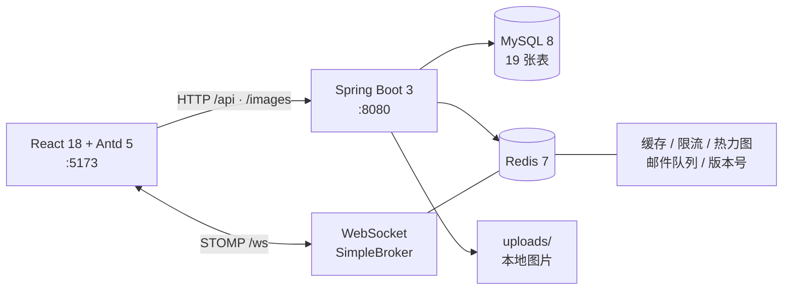

<div align="center">

# notehub · 刷题笔记社区

> 在题目下写下你的思考，被点赞、收藏、评论，见证每一次进步。


一个从零实现的全栈「刷题 + 笔记分享」平台：题库、Markdown 笔记、点赞收藏评论、
WebSocket 实时消息、全文搜索、数据可视化、AI 题解总结与每日打卡，
配套完整管理端（题库/题单/分类/用户/数据看板）。

**69 个 HTTP 接口 · 19 张表 · 212 后端测试 · 41 前端测试 · 194 项真实环境 E2E**

[功能](#功能) · [架构](#架构) · [技术亮点](#技术亮点) · [快速开始](#快速开始) · [测试](#测试) · [文档与博客](#文档与博客)

</div>

---

## 项目简介

notehub 是一个面向求职展示的完整全栈项目，目标不是再写一个 CRUD Demo，而是
把「刷题社区」这类产品真正会遇到的问题做出来：

- 题目、题单、笔记、标签、收藏夹之间的多表关系与聚合查询
- 点赞/收藏/评论的幂等、并发计数与死锁重试
- 全文搜索、缓存一致性、接口限流、文件清理
- WebSocket 实时通知与连接鉴权
- 管理端数据看板与内容运营
- 可复现的测试体系：单测 + 真实 MySQL/Redis E2E + 浏览器走查

<table>
  <tr>
    <td width="50%"></td>
    <td width="50%"></td>
  </tr>
  <tr>
    <td colspan="2"></td>
  </tr>
</table>

## 功能

### 用户端

- **账号**：邮箱验证码注册 / 登录（JWT）、个人资料、头像上传、他人主页
- **题库**：两级分类、难度/标签筛选、题单与个人刷题进度
- **笔记**：Markdown 双栏实时预览、一题一笔记、标签（默认继承题目）、编辑/删除
- **互动**：点赞（幂等）、多收藏夹、评论与楼中楼回复、评论点赞
- **消息**：点赞/评论通知、分类型未读角标、一键已读、点击跳转；WebSocket 实时推送
- **搜索**：全文索引 + Jieba 分词的笔记搜索、用户搜索、笔记热度榜
- **数据**：刷题热力图、个人数据卡片、每日打卡 streak、Markdown 导出
- **AI**：笔记一键题解总结，支持 OpenAI 兼容接口；未配置模型时本地抽取式摘要降级

### 管理端（`/admin`，仅管理员）

- **数据看板**：今日 6 项指标 + 每日快照趋势（23:59 定时落库）
- **题库管理**：筛选、CRUD、Markdown 批量导入（含失败明细）
- **题单管理**：题单 CRUD、条目增删与排序
- **分类管理**：两级树结构
- **用户管理**：检索、封禁/解封；封禁即时断开该用户已有 WebSocket 会话

## 技术栈

| 层 | 选型 |
|---|---|
| 后端 | Java 21 · Spring Boot 3.5 · Spring Security（仅 CORS/BCrypt）· MyBatis(XML) · MySQL 8 · Redis 7 · JJWT 0.12 · Log4j2 |
| 前端 | React 18 · TypeScript · Vite 5 · Ant Design 5 · Redux Toolkit · React Router 6 · axios · react-markdown(GFM) |
| 实时 | Spring WebSocket + STOMP 1.2（原生 WebSocket，无 SockJS） |
| 测试 | JUnit 5 + Mockito · Vitest + Testing Library · 真实环境 E2E 脚本 |

## 架构



**后端分层**

```
TraceIdFilter → TokenInterceptor → @NeedLogin/@NeedAdmin
    → Controller → Service → MyBatis Mapper(XML) → MySQL
    → Spring Event(@TransactionalEventListener) → 站内消息
    → EmailTaskConsumer(Redis List, 3s 轮询)
    → DailyStatisticTask(23:59 cron) / UploadCleanupTask(每周一 03:30)
```

**关键设计**

| 问题 | 方案 |
|---|---|
| 列表 N+1 | 列表联表取作者/题目，再用 `IN` 批量补“我是否点赞/收藏”，SQL 次数与页大小无关 |
| 并发计数 | 原子 `UPDATE` + 唯一约束 / `INSERT IGNORE`；无符号列先 `CAST AS SIGNED` 再 `GREATEST(...,0)` |
| 消息一致性 | 业务事务提交后异步投递（`AFTER_COMMIT`），回滚不产生幽灵消息；自赞自评不通知 |
| 并发死锁 | 点赞/取消混合并发下事务外层重试（`@RetryOnDeadlock`，指数退避 3 次） |
| 管理端鉴权 | 拦截器前置校验 `/api/admin/**`，早于参数绑定，再由 `@NeedAdmin` 双保险 |
| 多级缓存 | Caffeine(30s) → Redis(2~5min) → DB；版本号存 Redis，多实例失效即时生效 |
| 搜索缓存 | 版本号 + 关键词 SHA-256 + 分页；笔记增删改后版本号自增，旧缓存立即失效 |
| 实时鉴权 | STOMP CONNECT 校验 JWT + 用户未封禁；封禁时主动 `close(1008)` 全部已有会话 |

## 技术亮点

### 搜索：FULLTEXT(ngram) + Jieba + 可失效缓存

- MySQL `ngram` 全文索引处理中文 bigram，Jieba 负责查询侧分词与噪声清理
- 每个分词加引号后走 `BOOLEAN MODE` 短语匹配，避免只共享单个 bigram 的跨词误命中
- 缓存只存“笔记 ID + total”，VO 每次按当前用户补 `myActions`，不缓存个性化字段
- 缓存键使用 `版本号 + SHA-256`，规避 `String.hashCode` 碰撞；笔记写后版本号自增立即失效

### 数据可视化：Redis 位图 + 窗口聚合

- 热力图按天 1 字节存 Redis 位图，发布/删除笔记事件增量维护，未命中从库回填
- 热度榜 `week/month` 聚合 `note_daily_stats`，`all` 读累计计数列，5 分钟公共缓存
- 取消互动按**原始发生日**回退；级联删除跨日评论时按各自发生日分别回退
- Markdown 导出支持全部/单篇，仅作者可导出

### 实时消息：STOMP + 会话注册表

- 只推未读计数，不推消息体；前端 5s 重连并在重连后 HTTP 补拉一次
- 仅允许订阅 `/user/queue/**`，拒绝客户端 SEND；JWT 放 CONNECT 原生头
- `WsSessionRegistry` 绑定 `userId → WebSocketSession`（支持多标签页），封禁时主动断开
- 推送前再次检查封禁状态，覆盖“断开前推送已入队”的竞态

### 缓存与限流：Redis 共享版本 + 滑动窗口

- 两级缓存：Caffeine 防击穿（`get(key, loader)` 原子回源）+ Redis 跨实例共享
- 版本号放 Redis，任一节点失效后其他节点下次请求立即回源；Redis 故障退回本机版本
- 限流用 Redis ZSET + Lua 滑动窗口（Redis TIME），窗口内精确计数；Redis 故障 fail-open

### AI 与打卡

- AI 总结支持 OpenAI 兼容接口；未配置模型或调用失败自动降级本地抽取式摘要
- 模型结果缓存 6h，本地摘要缓存 10min；仅真正调用模型消耗 5 次/分钟
- 同一笔记并发未命中合并为一次生成；笔记编辑/删除后缓存失效
- 每日打卡主键幂等，连击最近一次为今天/昨天才延续，`status` 返回近 7 天轨迹

## 测试

```bash
cd backend  && mvn test        # 212 个后端测试（无需 DB/Redis）
cd frontend && npm test        # 41 个前端测试
cd frontend && npm run build   # 类型检查 + 生产构建
```

| 门禁 | 结果 |
|---|---|
| 后端单元/接口（JUnit 5 + Mockito） | **212 / 212** |
| 前端单元/组件（Vitest + Testing Library） | **41 / 41** |
| I1–I6 真实环境 E2E（MySQL + Redis + 后端） | **194 / 194** |
| S3 历史端到端接口验收 | **44 / 44** |
| AI 模型链路（本地 mock + DeepSeek 真实） | **18 / 18 + 13 / 13** |
| 多实例缓存一致性（双后端） | **11 / 11** |
| 浏览器 E2E（用户端 + 管理端 5 页面） | 通过 |

真实环境测试覆盖：注册登录、笔记 CRUD、点赞/收藏/评论、消息推送、搜索、标签、
热力图/榜单/导出、限流、文件清理、AI 总结、打卡、管理端权限与 5 个页面。
测试数据自建自清，不污染种子数据。详见 [验收报告](docs/test-report.md)。

## 快速开始

> 完整环境安装见 [环境手册](docs/environment-setup.md)。

```bash
# 0) 依赖：MySQL 8（服务运行）+ Redis（Docker）
docker run -d --name notehub-redis -p 6379:6379 redis:7-alpine

# 1) 初始化数据库
mysql -uroot -p -e "CREATE DATABASE notehub DEFAULT CHARACTER SET utf8mb4 COLLATE utf8mb4_unicode_ci;"
mysql -uroot -p notehub < backend/src/main/resources/db/schema.sql
mysql -uroot -p notehub < backend/src/main/resources/db/seed.sql

# 2) 本地配置（不入库）
cp backend/src/main/resources/application-local-template.yaml \
   backend/src/main/resources/application-local.yaml
# 填入数据库密码与 jwt.secret（≥32 字节随机串）

# 3) 后端 :8080
cd backend && mvn spring-boot:run

# 4) 前端 :5173
cd frontend && npm install && npm run dev
```

默认账号（来自 `seed.sql`，生产环境请修改）：

| 角色 | 账号 | 密码 |
|---|---|---|
| 管理员 | `admin` | `admin123` |
| 普通用户 | `demo` | `user123456` |

**可选配置**

- 邮件：默认 dev 模式（`mail.verify-code.enabled=false`），验证码由接口返回并自动填充；配置真实 SMTP 后可切换真发
- AI：`AI_SUMMARY_API_KEY=<key>` + `ai.summary.enabled=true` + `ai.summary.base-url`；不配置则使用本地摘要
- WebSocket：`ws://localhost:8080/ws`，开发期经 Vite `/ws` 代理

## 项目结构

```
notehub/
├── backend/                     # Spring Boot 3（com.notehub）
│   └── src/main/resources/
│       ├── db/                  # schema.sql / seed.sql / migration
│       ├── mapper/              # MyBatis XML
│       └── application-local-template.yaml
├── frontend/
│   └── src/
│       ├── apps/user/           # 首页/题目/题单/个人中心/他人主页/消息/搜索
│       ├── apps/admin/          # 看板/题库/题单/分类/用户
│       ├── domain/              # 按领域组织的 api / components / types
│       ├── request/             # axios 封装（token 注入、统一解包、40101 广播）
│       └── store/               # Redux Toolkit
└── docs/                        # 技术设计 / API / 环境 / 验收 / 博客 / 日志
```

## 文档与博客

| 文档 | 内容 |
|---|---|
| [技术复盘：从 0 到 1 做 notehub](docs/blog/notehub-engineering-retrospective.md) | 架构、六轮迭代、真实缺陷与取舍（长文） |
| [技术设计](docs/technical-design.md) | 架构、表结构、核心流程、错误码、安全清单 |
| [API 契约](docs/api-contract.md) | 69 个接口的方法/路径/权限/参数/响应 |
| [环境手册](docs/environment-setup.md) | 从零跑起来的每一步 |
| [验收报告](docs/test-report.md) | 测试覆盖、E2E 明细、已知限制 |
| [开发日志](docs/project-log.md) · [交接文档](docs/HANDOFF.md) | 过程记录与当前状态 |
| [同类项目调研](docs/prior-art.md) | 设计取舍参考 |

## 路线图

- [x] MVP：用户/题库/笔记/互动/消息/管理端/统计
- [x] I1 搜索：FULLTEXT(ngram) + Jieba + Redis 缓存
- [x] I2 数据可视化：热力图（Redis 位图）、热度榜、数据卡片、Markdown 导出
- [x] I3 实时化：WebSocket(STOMP) 未读推送、JWT 握手鉴权、封禁断开
- [x] I4 标签体系：题目/笔记双维度筛选，题目标签由考点同步
- [x] I5 深化：多级缓存、滑动窗口限流、每日互动统计、上传清理
- [x] I6 拓展：AI 题解总结（本地降级 + 可配置模型）、每日打卡 streak
- [x] S5 全量复测：I1–I6 专项 194 项 + 44 项回归 + 多实例/浏览器验收

## 已知限制

- 跨用户点赞/评论后，当前页面的笔记计数不会实时变化，需刷新或重新进入（设计内）
- 热力图单日计数为 u8，单日超过 255 篇会封顶（正常用户规模不可达）
- 搜索采用分词短语 OR 匹配，跨词拆开的模糊组合不再命中
- 每周孤儿图片清理依赖定时任务；即时清理已覆盖笔记删除/编辑与换头像

## 安全说明

- 密码 BCrypt；JWT 密钥仅存本地配置；仓库不含任何真实凭据
- 上传白名单（拒绝 svg）+ 5MB 限制 + UUID 重命名，静态目录无执行权限
- Markdown 默认不渲染原始 HTML，防 XSS；SQL 全参数化
- 所有管理接口双重校验（拦截器 + `@NeedAdmin`），资源写操作校验归属
- WebSocket CONNECT 校验 JWT + 封禁状态；封禁即时断开已有会话

## License

[MIT](LICENSE) © 2026 zaxiu88888
