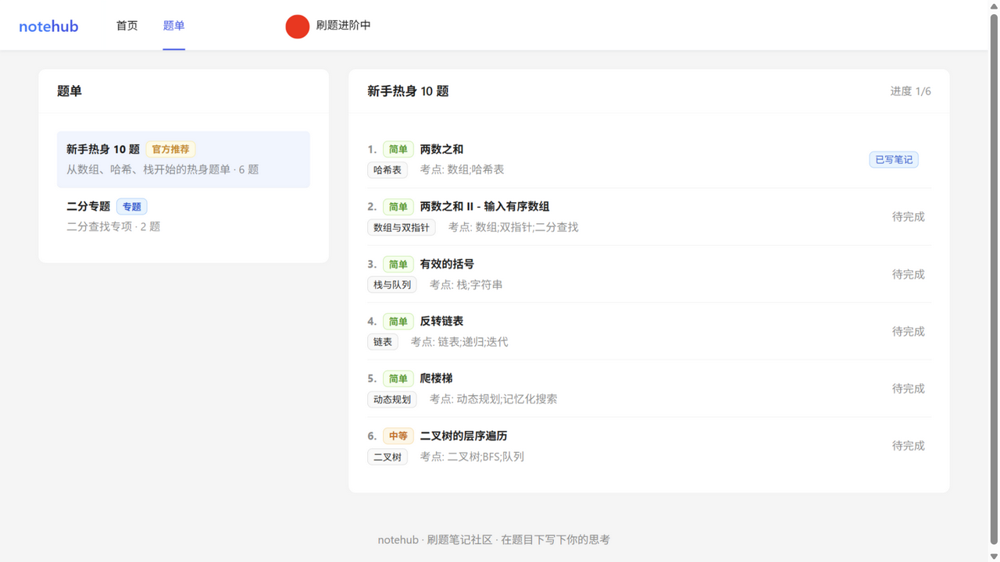
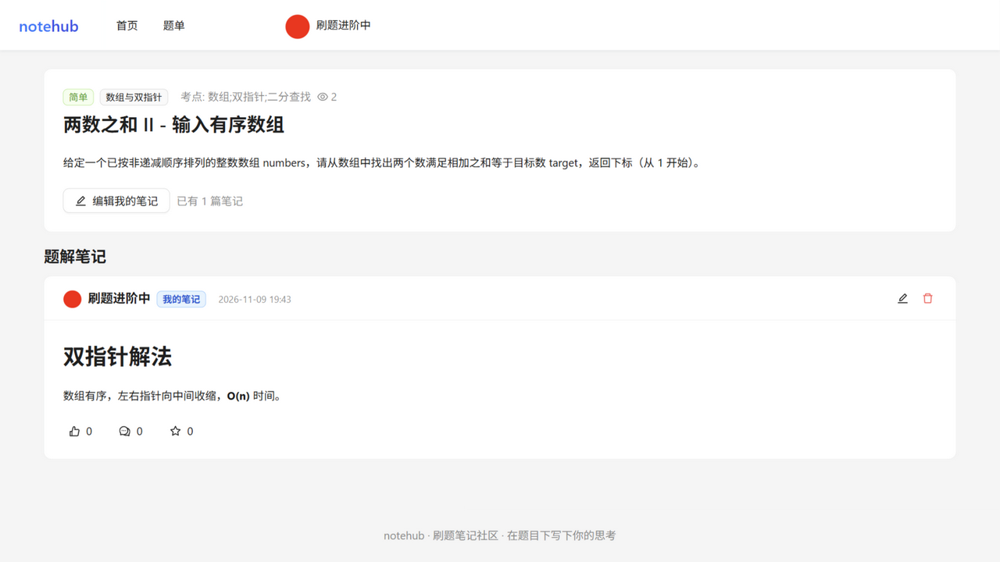
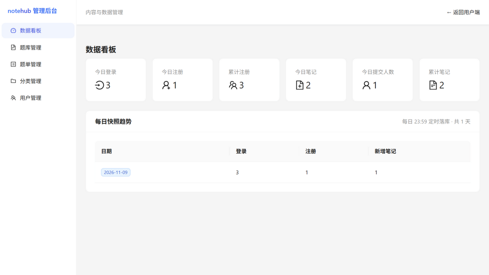

# notehub · 刷题笔记社区

> 在题目下写下你的思考，被点赞、收藏、评论，见证每一次进步。

一个从零实现的全栈「刷题 + 笔记分享」平台：用户浏览题库、在题目下写 Markdown 笔记、点赞/收藏/评论，并通过站内消息收到互动通知；管理端提供题库、题单、分类、用户与数据看板。





## 功能

**用户端**
- 邮箱验证码注册 / 登录（JWT），个人资料与头像上传
- 题库：两级分类、难度筛选、题单（含个人刷题进度）
- 笔记：Markdown 编辑（双栏实时预览）、一题一笔记、编辑/删除
- 互动：点赞（幂等）、多收藏夹、评论与楼中楼回复、评论点赞
- 消息中心：点赞/评论通知、分类型未读角标、一键已读、点击跳转目标笔记
- 搜索：顶栏关键词搜索笔记（全文索引 + Jieba）与用户
- 个人中心：资料管理、我的笔记、收藏夹管理；他人主页

**管理端**（`/admin`，仅管理员）
- 数据看板：今日 6 项指标 + 每日快照趋势（23:59 定时落库）
- 题库管理：筛选、CRUD、**Markdown 批量导入**（失败明细）
- 题单管理：题单 CRUD、条目增删与排序
- 分类管理：两级树结构
- 用户管理：检索、封禁/解封

## 技术栈

| 层 | 选型 |
|---|---|
| 后端 | Java 21 · Spring Boot 3.5 · Spring Security(仅 CORS/BCrypt) · MyBatis(XML) · MySQL 8 · Redis · JJWT 0.12 · Log4j2 |
| 前端 | React 18 · TypeScript · Vite 5 · Ant Design 5 · Redux Toolkit · React Router 6 · axios · react-markdown(GFM) |
| 测试 | JUnit 5 + Mockito · Vitest + Testing Library |

## 架构要点

```
React 18 (Antd5, :5173) ──HTTP /api, /images (Vite proxy)──▶ Spring Boot 3 (:8080)
                                                              ├─ TraceIdFilter → TokenInterceptor → @NeedLogin/@NeedAdmin
                                                              ├─ Controller → Service → MyBatis Mapper(XML)
                                                              ├─ Spring Event(@TransactionalEventListener) → 站内消息
                                                              ├─ EmailTaskConsumer(Redis List, 3s 轮询)
                                                              └─ DailyStatisticTask(23:59 cron)
                                                              │
                                          MySQL 8 (14 表) ◀──┤──▶ Redis(验证码/限流/队列)
                                          本地磁盘 uploads/ ◀──┘
```

设计说明（详见 [技术设计](docs/technical-design.md)）：
- **防 N+1 聚合**：列表联表取作者/题目，再用 IN 批量补“我是否点赞/收藏”，SQL 次数与页大小无关
- **原子计数**：`GREATEST(x + delta, 0)` + 唯一约束/`INSERT IGNORE` 保证幂等与并发安全
- **事件驱动消息**：业务事务提交后异步投递（`AFTER_COMMIT`），回滚不产生幽灵消息，自赞自评不通知
- **死锁重试**：点赞/取消混合并发下唯一索引可能短暂死锁，事务外层重试 3 次（`@RetryOnDeadlock`）
- **鉴权前置**：`/api/admin/**` 在拦截器层校验，早于参数绑定，避免匿名请求先泄露校验细节

## 快速开始

> 完整环境安装见 [环境手册](docs/environment-setup.md)。

```bash
# 0) 依赖：MySQL 8（服务运行）+ Redis（Docker: docker run -d --name notehub-redis -p 6379:6379 redis:7-alpine）

# 1) 初始化数据库
mysql -uroot -p -e "CREATE DATABASE notehub DEFAULT CHARACTER SET utf8mb4 COLLATE utf8mb4_unicode_ci;"
mysql -uroot -p notehub < backend/src/main/resources/db/schema.sql
mysql -uroot -p notehub < backend/src/main/resources/db/seed.sql

# 2) 本地配置（不入库）
cp backend/src/main/resources/application-local-template.yaml \
   backend/src/main/resources/application-local.yaml
# 填入数据库密码与 jwt.secret（≥32 字节随机串）

# 3) 后端 :8080
cd backend && mvn spring-boot:run

# 4) 前端 :5173
cd frontend && npm install && npm run dev
```

默认账号（来自 `seed.sql`，请在生产环境修改）：

| 角色 | 账号 | 密码 |
|---|---|---|
| 管理员 | `admin` | `admin123` |
| 普通用户 | `demo` | `user123456` |

邮件默认 **dev 模式**（`mail.verify-code.enabled=false`）：注册验证码不发邮件，直接由接口返回并在前端自动填充；配置真实 SMTP 后即可切换为真发。

## 测试

```bash
cd backend  && mvn test      # 123 个后端测试
cd frontend && npm test      # 18 个前端测试
cd frontend && npm run build # 类型检查 + 生产构建
```

此外完成了 44 项真实环境端到端验收（注册→笔记→点赞→消息→收藏→上传→管理端），详见 [验收报告](docs/test-report.md)。

## 目录结构

```
notehub/
├── backend/                     # Spring Boot 3（com.notehub）
│   └── src/main/resources/
│       ├── db/                  # schema.sql / seed.sql
│       ├── mapper/              # MyBatis XML
│       └── application-local-template.yaml
├── frontend/
│   └── src/
│       ├── apps/user/           # 用户端页面（首页/题目/题单/个人中心/他人主页/消息）
│       ├── apps/admin/          # 管理端页面（看板/题库/题单/分类/用户）
│       ├── domain/              # 按领域组织的 api / components / types
│       ├── request/             # axios 封装（token 注入、统一解包、40101 广播）
│       └── store/               # Redux Toolkit
└── docs/                        # 技术设计 / API 契约 / 环境手册 / 验收报告 / 日志
```

## 文档

| 文档 | 内容 |
|---|---|
| [技术设计](docs/technical-design.md) | 架构、表结构、核心流程、错误码、安全清单 |
| [API 契约](docs/api-contract.md) | 全量接口：方法/路径/权限/参数/响应 |
| [环境手册](docs/environment-setup.md) | 从零跑起来的每一步 |
| [验收报告](docs/test-report.md) | 测试覆盖、E2E 明细、已知限制 |
| [同类项目调研](docs/prior-art.md) | 设计取舍参考 |
| [开发日志](docs/project-log.md) · [交接文档](docs/HANDOFF.md) | 过程记录与当前状态 |

## 路线图

- [x] MVP：用户/题库/笔记/互动/消息/管理端/统计
- [x] I1 搜索：MySQL FULLTEXT(ngram) + Jieba 分词 + Redis 缓存
- [x] I2 数据可视化：GitHub 风格热力图（Redis 位图）、笔记热度榜、个人数据卡片、Markdown 导出
- [ ] I3 实时化：WebSocket 推送未读消息（替代轮询）
- [ ] I4 标签体系：题目/笔记标签与多维索引
- [ ] I5 深化：缓存分层、限流反垃圾、计数去重统计表
- [ ] I6 拓展：AI 题解总结、打卡 streak

## 安全说明

- 密码 BCrypt；JWT 密钥仅存本地配置；仓库不含任何真实凭据
- 上传白名单（拒绝 svg）+ 5MB 限制 + UUID 重命名，静态目录无执行权限
- Markdown 默认不渲染原始 HTML，防 XSS；SQL 全参数化
- 所有管理接口双重校验（拦截器 + `@NeedAdmin`），资源写操作校验归属

## License

[MIT](LICENSE) © 2026 zaxiu88888
