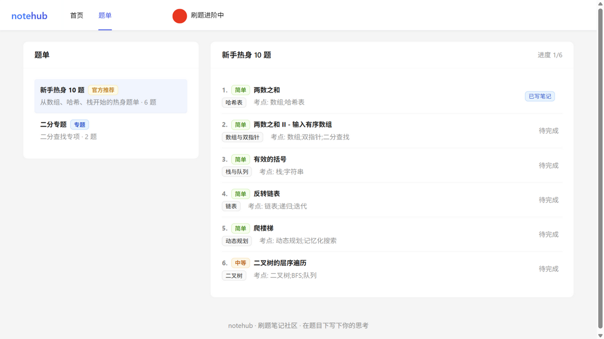
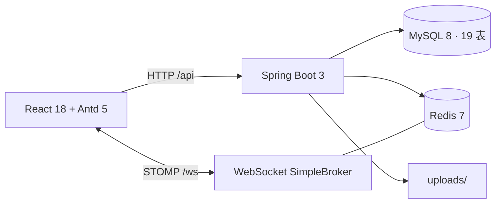

# 从 0 到 1 做一个刷题笔记社区：notehub 的架构、六轮迭代与踩坑复盘

> 项目：notehub（刷题 + 笔记分享社区）  
> 技术栈：Java 21 / Spring Boot 3.5 / MyBatis / MySQL 8 / Redis 7 / React 18 / TypeScript  
> 规模：69 个接口、19 张表、约 1.6 万行业务代码  
> 测试：212 后端 + 41 前端 + 194 项真实环境 E2E + 44 项历史验收

## 1. 为什么做 notehub

求职项目最容易陷入两个极端：要么是只有增删改查的“后台管理系统”，要么是功能堆满但讲不清取舍的 Demo。

notehub 选择了一个有真实业务张力的题目：**刷题社区**。它同时包含：

- 内容侧：题目、题单、笔记、标签、评论
- 互动侧：点赞、收藏、消息、未读角标
- 数据侧：热力图、热度榜、互动统计、每日打卡
- 运营侧：题库/题单/分类/用户管理、数据看板

这些模块彼此关联，能自然带出缓存、并发、搜索、实时通信、权限和测试等工程问题，而不是为了用技术而用技术。

## 2. 产品一页

**用户端**

- 邮箱验证码注册/登录，JWT 鉴权，个人资料与头像
- 两级分类 + 难度/标签筛选的题库，题单与个人刷题进度
- Markdown 双栏编辑，一题一笔记，标签默认继承题目
- 点赞幂等、多收藏夹、两级评论与评论点赞
- WebSocket 实时未读角标，消息分类型筛选与一键已读
- 全文搜索、用户搜索、笔记热度榜
- 热力图、数据卡片、每日打卡、Markdown 导出
- AI 题解总结（OpenAI 兼容接口，未配置时本地摘要降级）

**管理端**

- 数据看板：今日 6 项指标 + 每日快照趋势
- 题库：筛选、CRUD、Markdown 批量导入
- 题单：CRUD、条目增删与排序
- 分类：两级树
- 用户：检索、封禁/解封，封禁即时断开已有 WebSocket 会话



## 3. 架构



后端请求链路：

```
TraceIdFilter
  → TokenInterceptor（解析 Bearer、查 users、封禁按匿名、管理端前置校验）
  → @NeedLogin / @NeedAdmin
  → Controller → Service → MyBatis Mapper(XML)
  → Spring Event(@TransactionalEventListener AFTER_COMMIT) → 站内消息
```

Redis 在项目里承担了五类职责：

| 用途 | 结构 |
|---|---|
| 缓存 | 题库/分类/标签两级缓存 + 版本号 |
| 限流 | ZSET + Lua 滑动窗口 |
| 热力图 | 按天 u8 位图 |
| 邮件队列 | List 左进右出，消费者 3s 轮询 |
| 搜索缓存 | 版本号 + SHA-256 键，只存 ID/total |

## 4. 六轮迭代，每轮解决一个真问题

### I1 搜索：ngram + Jieba，但缓存才是难点

第一版搜索很直接：`search_vector = 题目标题 + 正文`，MySQL 建 `FULLTEXT ... WITH PARSER ngram`，查询侧用 Jieba 分词。

真正踩坑的是缓存：

- 缓存键最初用 `keyword.hashCode()`，不同关键词可能碰撞。实测 `gtmllind` 与 `wrapbhzi` 的 Java 哈希相同，搜索 B 会拿到 A 的结果。
- 后来改成 `SHA-256`，并引入 Redis 版本号：笔记增删改后版本号自增，旧缓存键自然失效。
- `selectByIds` 是 `IN` 查询，不保证顺序；从缓存回填后要按 ID 顺序还原相关度排序。
- `NATURAL LANGUAGE` 模式下，ngram 会把查询拆成 bigram，`collision` 可能命中只含 `complement` 的笔记（共享 `co`）。最终改成逐词加引号的 `BOOLEAN MODE` 短语匹配，过滤跨词低分噪声。

### I2 数据可视化：位图、窗口聚合、导出

- 热力图按“每天 1 字节”存 Redis 位图，发布/删除笔记通过事件增量维护；缓存未命中从 MySQL 按天聚合回填。
- 热度榜 `week/month` 聚合 `note_daily_stats`，`all` 读 `notes` 累计计数列；公共数据缓存 5 分钟。
- 取消互动必须按**原始发生日**回退：取消点赞要回退到点赞那天，而不是操作当天。
- 导出是 Markdown 附件，带 `Content-Disposition`，仅作者可导出。

### I3 实时消息：STOMP 只推计数

消息体不推送，只推 `{total, like, comment, system}`。原因：

- 推送链路轻，不会把私密内容广播到错误会话；
- 消息列表仍按需分页拉取，前端连接/重连后 HTTP 补拉一次；
- 只允许订阅 `/user/queue/**`，拒绝客户端 SEND。

后来补了两个安全点：

1. CONNECT 除 JWT 外查 `users`，封禁/已删除用户拒绝新连接；
2. `WsSessionRegistry` 登记底层 `WebSocketSession` 并绑定 `userId`，封禁时主动 `close(1008)` 全部已有会话；推送前再查一次封禁状态兜底。

这里有一个 Spring 细节：`SessionConnectedEvent` 的 message header 不是 `StompHeaderAccessor`，而是 `SimpMessageHeaderAccessor`。第一版用错 accessor 导致 `sessionId/user` 取空，封禁时找不到会话；改为 `event.getUser()` + `SimpMessageHeaderAccessor.getSessionId(headers)` 后才生效。

### I4 标签：题目标签唯一来源是考点

- `questions.exam_point` 是题目标签的唯一来源，创建/编辑/批量导入时拆分并重建 `question_tags`。
- 笔记标签默认继承题目标签快照，作者可改；题目后来改考点不会回溯覆盖存量笔记，避免冲掉作者自定义。
- 标签名大小写不敏感去重，支持 `#` 前缀归一；题目/笔记都支持 `?tag=` 筛选。

### I5 深化：缓存、限流、统计、文件清理

- **多级缓存**：Caffeine(30s) → Redis(2~5min) → DB；`Caffeine.get(key, loader)` 原子回源防击穿。
- **多实例一致性**：版本号最初在 JVM 内存，其他节点 L1 最长滞后 30s。后来改为 Redis `cache:version:{domain}`，任一节点失效后其他节点下次请求算新 key，直接绕过旧 L1。
- **滑动窗口限流**：Redis ZSET + Lua + Redis TIME，窗口内精确计数；Redis 故障 fail-open。
- **每日互动统计**：`note_daily_stats` 主键 `(note_id, date)`，点赞/评论/收藏原子 upsert；取消按发生日回退。
- **上传清理**：笔记删除/编辑、换头像时按引用计数清理；每周一 03:30 扫描 24h 前孤儿文件。

### I6 AI 与打卡

- AI 默认关闭；未配置模型或调用失败自动降级 `LocalSummarizer` 抽取式摘要。
- 模型结果缓存 6h，本地摘要 10min；只有真正调用模型才消耗 5 次/分钟，缓存命中和本地摘要不限流。
- 同一笔记并发未命中用内存锁 + 双重检查合并为一次生成。
- 打卡主键 `(user_id, date)` 幂等，连击最近一次为今天/昨天才延续，`status` 返回近 7 天轨迹。

## 5. 几个值得复盘的缺陷

### 5.1 删除跨日评论返回 500

**现象**：删除一条昨天创建的父评论（带今天的回复）返回 500。

**根因有两层**：

1. 级联删除时按父评论单日扣 `1 + 回复数`；
2. `note_daily_stats.comment_count` 是 `INT UNSIGNED`，`GREATEST(count + (-2), 0)` 会先发生无符号下穿，再被 `GREATEST` 兜底，MySQL 直接抛 `MysqlDataTruncation`。

**修复**：

- 删除前取存活回复（含 `created_at`），按各评论发生日分别回退；
- 所有无符号计数更新先 `CAST(... AS SIGNED)` 再加减，最后 `GREATEST(..., 0)`。

### 5.2 鉴权切面让导出接口 500

`AuthAspect` 最初未登录时直接 `return ApiResponse.error(...)`。大多数接口返回 `ApiResponse` 没问题，但 `GET /notes/download` 返回 `ResponseEntity<byte[]>`，Spring 强转失败 → 500。

修复：切面统一抛 `BusinessException`，交给 `GlobalExceptionHandler` 输出 40101/40102。这个改动让“未登录导出”从 500 变成正确的 40101。

### 5.3 评论后卡片评论数不刷新

题目页发表评论后，评论抽屉里已有新评论，但卡片角标还是旧值。原实现担心“整页 reload 会卸载抽屉”，所以没有接 `onCountChange`。

修复：按 noteId 拉取单篇笔记，局部替换列表项，不卸载抽屉，也不触发整页重载。

### 5.4 搜索缓存串结果

`String.hashCode` 碰撞不是理论问题。构造两个哈希相同的关键词后，搜索第二个会命中第一个的缓存。改为 SHA-256 后消失；同时用版本号解决“编辑/删除后 5 分钟内仍搜到旧结果”。

## 6. 测试策略

项目坚持“三道门”：每次改动必须 commit、测试全绿、里程碑前 diff 自审。

测试分四层：

| 层 | 数量 | 作用 |
|---|---|---|
| 后端单测/接口 | 212 | Service 逻辑、鉴权、缓存、搜索、WS、AI、统计 |
| 前端组件 | 41 | 页面渲染、交互、Redux、Markdown/XSS、管理端守卫 |
| 真实环境 E2E | 194 | I1–I6 专项：搜索/数据/实时/标签/深化/AI |
| 历史验收 + 专项 | 44 + 18 + 13 + 11 | S3 回归、AI mock、DeepSeek 真模型、双实例缓存 |

真实环境测试使用临时账号/临时笔记/临时题，跑完通过 API + SQL 清理，
不破坏 `admin`/`demo`/种子题目/题单。浏览器走查覆盖用户端全链路与管理端 5 页面。

## 7. 取舍与已知限制

- **跨用户实时计数**：只推个人未读计数，不推笔记点赞/评论数；当前页计数需刷新。
- **热力图**：按天 u8，单日 255 封顶；正常用户规模不可达。
- **搜索短语模式**：分词短语 OR 匹配，跨词拆开的模糊组合不再命中；换来更少噪声。
- **多实例缓存**：版本号已放 Redis，但旧 L1 条目仍会占用最多 30s 内存后自然淘汰。
- **第三方模型**：已用 DeepSeek 真实联调和本地 mock 覆盖协议/限流/降级；生产使用需自备 Key。

## 8. 面试可以怎么讲

1. **搜索缓存**：为什么不用 `hashCode`、为什么加版本号、为什么缓存 ID 而不是 VO。
2. **并发计数**：唯一约束 + 原子 UPDATE + 死锁重试；无符号列的隐藏坑。
3. **实时消息**：为什么只推计数、CONNECT 鉴权、封禁如何踢下线、多标签页怎么处理。
4. **缓存一致性**：Caffeine 防击穿、Redis 版本号跨实例失效、故障降级。
5. **测试体系**：单测之外，如何用真实 MySQL/Redis 做可清理的 E2E。

## 9. 相关链接

- [README](../../README.md)
- [技术设计](../technical-design.md)
- [API 契约](../api-contract.md)
- [验收报告](../test-report.md)
- [开发日志](../project-log.md)

---

如果这个项目对你有帮助，欢迎 Star。也欢迎在 Issues 里讨论缓存、搜索或实时消息的设计取舍。
